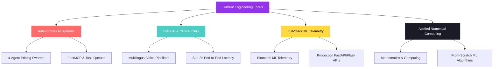
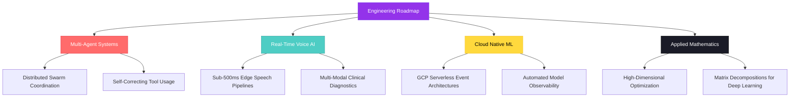

<div align="center">
    
#  Parth Tyagi

**AI Engineer & Full-Stack Systems Builder** | Python · FastAPI · Groq · LiveKit · Multi-Agent Systems · GCP

<a href="https://github.com/parthTyagi-tech">
  
</a>

[](mailto:parthtyagi3389@gmail.com)
[](https://www.linkedin.com/in/tyagiParth)
[](https://parthtyagi-tech.github.io/portfolio/)
[](https://github.com/parthTyagi-tech)
[](https://www.quora.com/profile/Parth-Tyagi-139)

<br>


</div>

---

<div align="center">

###  Quick Navigation

[ Stats](#-github-stats) · [ About](#-about-me) · [ Tech Stack](#️-tech-stack) · [ Featured Projects](#-featured-projects) · [ Deep-Dive Labs](#-deep-dive-technical-labs) · [ Additional Projects](#-additional-ai--ml-projects) · [🗺️ Roadmap](#️-roadmap--focus)

</div>

---

<div align="center">

</div>

##  GitHub Stats

<div align="center">


<br>


<br>


</div>

---

## ⭐ Repository Highlights

<div align="center">


</div>

---

<div align="center">

</div>

##  About Me

```typescript
const parth: Engineer = {
  name:       "Parth Tyagi",
  role:       "AI Engineer & Full-Stack Systems Builder",
  education:  "B.Tech in Mathematics & Computing @ Central University of Karnataka (2023 - 2027)",

  focus: [
    " Autonomous Multi-Agent Systems & Dynamic Pricing Swarms",
    " Real-Time Clinical Voice AI & Low-Latency RAG Pipelines (<850ms)",
    " Deterministic Guardrails, LangGraph Workflows & Async Task Queues",
    " Full-Stack ML Telemetry & Applied Numerical Computing",
  ],

  experience: [
    "AI Engineer Intern @ Intellexia Tech Pvt. Ltd. (Voice Agents & GCP)",
    "AI/ML Intern @ YBI Foundation (End-to-End Predictive Pipelines)",
    "Data Analytics Virtual Experience @ Deloitte",
    "GenAI Analytics Virtual Experience @ TATA",
  ],

  certifications: [
    " NPTEL Elite + Silver Medal: Deep Learning (IIT Ropar)",
    " NPTEL Elite: Essential Mathematics for ML (IIT Roorkee)",
  ],

  stack: {
    languages:   ["Python", "C++", "SQL", "JavaScript", "MATLAB"],
    backend:     ["FastAPI", "Flask", "Asyncio", "FastMCP", "REST APIs", "WebRTC", "SSE Streaming"],
    databases:   ["PostgreSQL", "Redis", "Pinecone", "SQLAlchemy"],
    ai_ml:       ["Groq (Llama 3.3-70B)", "LiveKit", "Deepgram Aura-2", "Scikit-Learn", "PyTorch", "XGBoost", "LangGraph", "LangChain", "Crawl4AI"],
    cloud_devops:["Docker", "Google Cloud (Cloud Run, Cloud Tasks)", "Render", "Vercel", "Linux", "Git", "GitHub"],
  },

  philosophy: "Build things that work. Document things that last.",
};
```

<div align="center">

```bash
curl -s https://parthtyagi-tech.github.io/portfolio/  # Live Portfolio & Production Demos
```

</div>

---

<div align="center">

</div>

## 🛠️ Tech Stack

<div align="center">

<a href="https://skillicons.dev">
  
</a>

<br><br>

**Core Languages**


**Backend & Multi-Agent Frameworks**


**Data, Vector & Cache Stores**


**AI, Voice Systems & Machine Learning**


**Cloud & Infrastructure**


</div>

---

<div align="center">

</div>

##  Featured Projects

### ⭐ Flagship: Klypup — Dynamic Pricing Intelligence Platform

**[Klypup](https://github.com/parthTyagi-tech/dynamic-pricing-intelligence-platform)** — *Autonomous 4-Agent Swarm with Real-Time Market Intelligence.*

An enterprise-grade multi-agent platform engineering automated pricing decisions with deterministic safeguard boundaries, market telemetry extraction, and human-in-the-loop governance.

-  **4-Agent Collaborative Swarm** — Specialized agents (Coordinator, Scraper via Crawl4AI + FastMCP, Analyzer for price elasticity & competitor benchmarking, Strategy for recommendation modeling) orchestrated seamlessly without race conditions.
-  **Asynchronous Cloud Task Queue** — Decoupled execution utilizing GCP Cloud Tasks and Celery backplanes to handle rate-limited target data sources reliably.
-  **Explainable AI & Safety Guardrails** — Enforces hard margin floors, anomaly-detection circuit breakers, and human-in-the-loop approval gates before dynamic price publishing.
-  **Real-Time Telemetry Dashboard** — Server-Sent Events (SSE) streaming live pricing updates, elasticity shifts, and competitor movements directly to modern client interfaces.
-  **Containerized & Production Ready** — Fully containerized using Docker, with automated environment validation and structured JSON logging.


**Engineering rigor:** Modular agent boundaries, deterministic safety checks, clean state transitions, and high-concurrency async task scheduling.

**[→ View Repository](https://github.com/parthTyagi-tech/dynamic-pricing-intelligence-platform)**

---

<div align="center">

</div>

##  Deep-Dive Technical Labs

> Two production-grade, systems-focused projects exploring low-latency clinical conversational AI and high-precision biometric predictive telemetry.

<table>
<tr>
<td width="50%" valign="top">

###  [MediAssist (medibot)](https://github.com/parthTyagi-tech/medibot)

**Clinical RAG Agent & Multi-Lingual Voice AI.**

A low-latency medical voice assistant designed for clinical triage, combining conversational speech synthesis with deterministic retrieval guardrails.

-  **Sub-3000ms Voice Latency** — End-to-end voice loop orchestrating Deepgram Aura-2 STT/TTS and LiveKit WebRTC streaming.
-  **Groq + Llama 3.3-70B** — High-throughput inference for conversational clinical Q&A with strict medical disclaimers.
-  **Pinecone Vector Retrieval** — Semantic search across verified medical knowledge graphs with contextual citation.
-  **11-Metric Evaluation Framework** — LangSmith integrated pipeline auditing faithfulness, relevancy, and hallucination bounds.
-  **7-Language Support** — Multi-lingual clinical guidance with real-time translation failovers.


**[→ Explore MediAssist](https://github.com/parthTyagi-tech/medibot)**

</td>
<td width="50%" valign="top">

###  [AI Fitness Intelligence System](https://github.com/parthTyagi-tech/AI-Driven-Fitness-Intelligence-System)

**Biometric Telemetry & Anthropometric ML Engine.**

An end-to-end predictive analytics platform modeling body composition and physiological metrics from non-invasive anthropometric parameters.

-  **R² = 0.995 / 0.21% MAE** — Validated regression accuracy benchmark (profile benchmark up to 0.997 R² / 0.071% MAE) across diverse cohorts.
-  **Optimized Gradient Boosting** — XGBoost and Scikit-Learn pipelines tuned via Bayesian cross-validation and feature-importance attribution.
-  **Production Serving API** — Accompanied by **[AI-Fitness-API](https://github.com/parthTyagi-tech/AI-Fitness-API)** for sub-50ms inference delivery.
-  **Secure Persistence** — Integrated with PostgreSQL, SQLAlchemy ORM, and Google OAuth 2.0 user session management.
-  **Cloud Native Deployment** — Fully deployed on Render with automated build hooks and continuous health monitoring.


**[→ Explore the System](https://github.com/parthTyagi-tech/AI-Driven-Fitness-Intelligence-System)**

</td>
</tr>
</table>

<div align="center">

<a href="https://github.com/parthTyagi-tech/dynamic-pricing-intelligence-platform">
  
</a>
<a href="https://github.com/parthTyagi-tech/medibot">
  
</a>

<br>

<a href="https://github.com/parthTyagi-tech/AI-Driven-Fitness-Intelligence-System">
  
</a>
<a href="https://github.com/parthTyagi-tech/AIJobSkillGapAnalyzer">
  
</a>

</div>

---

###  Additional AI & ML Projects

| Project | Description | Tech | Live Demo | Source |
|---|---|---|---|---|
|  **AIJobSkillGapAnalyzer** | NLP-driven career analysis and retrieval platform aligning candidate profiles with job role specifications to identify missing competencies. |   | — | [Repo](https://github.com/parthTyagi-tech/AIJobSkillGapAnalyzer) |
|  **AI-Fitness-API** | Production Flask REST API serving biometric body composition predictions with serialized model artifacts. |   | — | [Repo](https://github.com/parthTyagi-tech/AI-Fitness-API) |
|  **Movie-Recommend-System** | Content-based recommendation engine utilizing NLP cosine similarity and vector space modeling. |   | — | [Repo](https://github.com/parthTyagi-tech/Movie-Recommend-System) |
|  **Crowd-Counting** | Computer vision density estimation model leveraging deep convolutional networks for automated crowd analysis. |   | — | [Repo](https://github.com/parthTyagi-tech/Crowd-Counting) |
|  **HeartDiseaseprediction** | Supervised clinical classification pipeline predicting cardiovascular disease risk from patient health biomarkers. |  | — | [Repo](https://github.com/parthTyagi-tech/HeartDiseaseprediction) |
|  **women-cloth-reviews-prediction** | NLP sentiment analysis and text classification pipeline categorizing consumer feedback trends. |   | — | [Repo](https://github.com/parthTyagi-tech/women-cloth-reviews-prediction) |

---

### 🔬 From-Scratch ML Implementations

| Implementation | Mathematical Core & Scope | Tech | Source |
|---|---|---|---|
|  **Multi-Linear-Regression-from-Scratch-** | Vectorized multivariate ordinary least squares (OLS) and batch gradient descent with loss convergence tracking. |  | [Repo](https://github.com/parthTyagi-tech/Multi-Linear-Regression-from-Scratch-) |
|  **simple-linear-regression-from-scratch** | Closed-form analytical slope derivation and cost minimization without high-level ML dependencies. |  | [Repo](https://github.com/parthTyagi-tech/simple-linear-regression-from-scratch) |
|  **Perceptron-Model-VS-Scikit-Logistic-Regression** | Empirical comparative study benchmark: custom Single-Layer Perceptron decision boundary vs Scikit-Learn Logistic Regression. |  | [Repo](https://github.com/parthTyagi-tech/Perceptron-Model-VS-Scikit-Logistic-Regression) |
|  **Logistic-Regression** | Sigmoid activation, binary cross-entropy loss optimization, and decision thresholding built from scratch. |  | [Repo](https://github.com/parthTyagi-tech/Logistic-Regression) |
|  **Linear-Regression** | Foundational linear modeling, residual variance analysis, and hyperparameter impact analysis. |  | [Repo](https://github.com/parthTyagi-tech/Linear-Regression) |

---

###  Web & Applications

| Project | Description | Tech | Live Demo | Source |
|---|---|---|---|---|
| **portfolio** | Personal responsive portfolio website featuring technical projects, live demos, and background. |   | [Visit](https://parthtyagi-tech.github.io/portfolio/) | [Repo](https://github.com/parthTyagi-tech/portfolio) |
| **AmazonClone** | Modern front-end e-commerce interface clone demonstrating responsive layouts and interactive DOM states. |  | — | [Repo](https://github.com/parthTyagi-tech/AmazonClone) |

---

###  What I'm Building



---

<div align="center">

## 🌟 Skills & Expertise

</div>

<table>
  <tr>
    <td width="33%" valign="top">
      <h3> Currently Focused On</h3>
      -  Autonomous <strong>Multi-Agent Swarms</strong><br>
      -  Real-time <strong>Voice AI & Clinical RAG</strong><br>
      -  Deterministic <strong>LLM Guardrails</strong><br>
      -  <strong>FastAPI & GCP Cloud Tasks</strong><br>
      -  <strong>Applied Biometric Telemetry</strong><br>
      -  <strong>Numerical Computing</strong> (NumPy/C++)<br>
      -  Open to <strong>High-Impact Collaborations</strong>
    </td>
    <td width="33%" valign="top">
      <h3> Certifications & Honors</h3>
      -  <strong>NPTEL Elite + Silver Medal</strong><br>
      &nbsp;&nbsp;<em>Deep Learning (IIT Ropar)</em><br>
      -  <strong>NPTEL Elite</strong><br>
      &nbsp;&nbsp;<em>Essential Mathematics for ML (IIT Roorkee)</em><br>
      -  <strong>B.Tech Mathematics & Computing</strong><br>
      &nbsp;&nbsp;<em>Central University of Karnataka</em><br>
      -  <strong>AI Engineer Intern</strong><br>
      &nbsp;&nbsp;<em>Intellexia Tech Pvt. Ltd.</em><br>
      -  <strong>AI/ML Intern</strong><br>
      &nbsp;&nbsp;<em>YBI Foundation</em>
    </td>
    <td width="33%" valign="top">
      <h3> Always Learning & Building</h3>
      -  Reading <strong>Core AI Research Papers</strong><br>
      -  Engineering <strong>Resilient Production Systems</strong><br>
      -  Exploring <strong>High-Dimensional Optimization</strong><br>
      -  Designing <strong>Algorithmic Implementations</strong><br>
      -  Deploying <strong>Cloud-Native Architectures</strong><br>
      -  Documenting <strong>Things that Last</strong><br>
      -  Shipping <strong>Clean, Tested Code</strong>
    </td>
  </tr>
</table>

<div align="center">
  <em>*Bridging rigorous mathematical foundations with modern production AI engineering.*</em>
</div>

---

<div align="center">

</div>

## 🗺️ Roadmap & Focus



---

<div align="center">


<br>

### 🌟 *"Build things that work. Document things that last."*

<br>

### 🤝 Let's Build Something Impactful

[](mailto:parthtyagi3389@gmail.com)
[](https://www.linkedin.com/in/tyagiParth)
[](https://parthtyagi-tech.github.io/portfolio/)
[](https://github.com/parthTyagi-tech)

<br>


<br>


**⭐️ From [parthTyagi-tech](https://github.com/parthTyagi-tech) — Built with Precision in Markdown**


</div>
